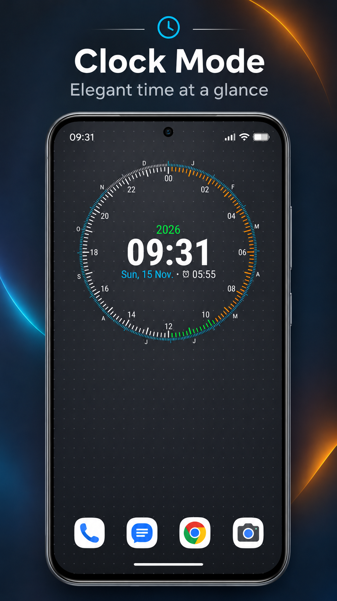
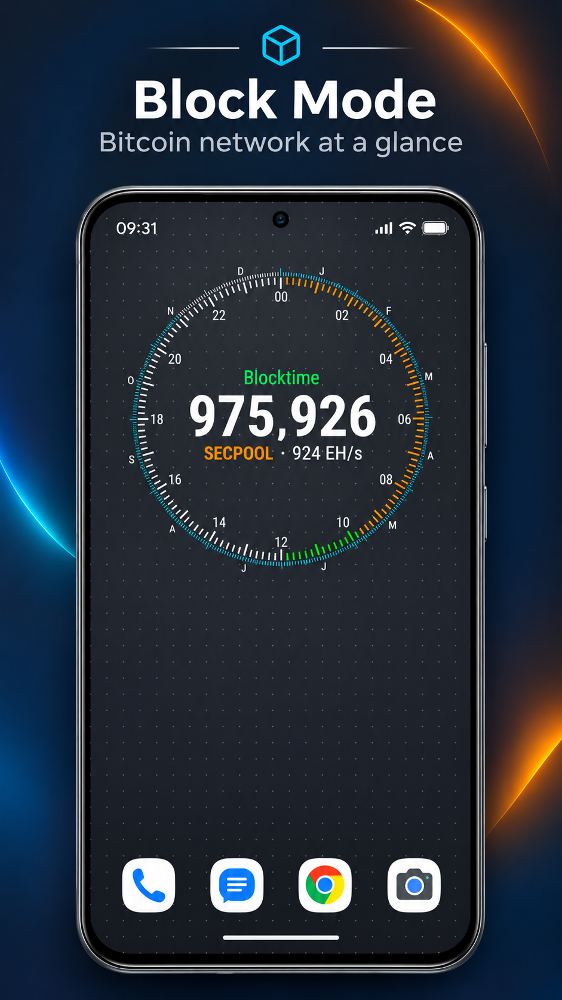
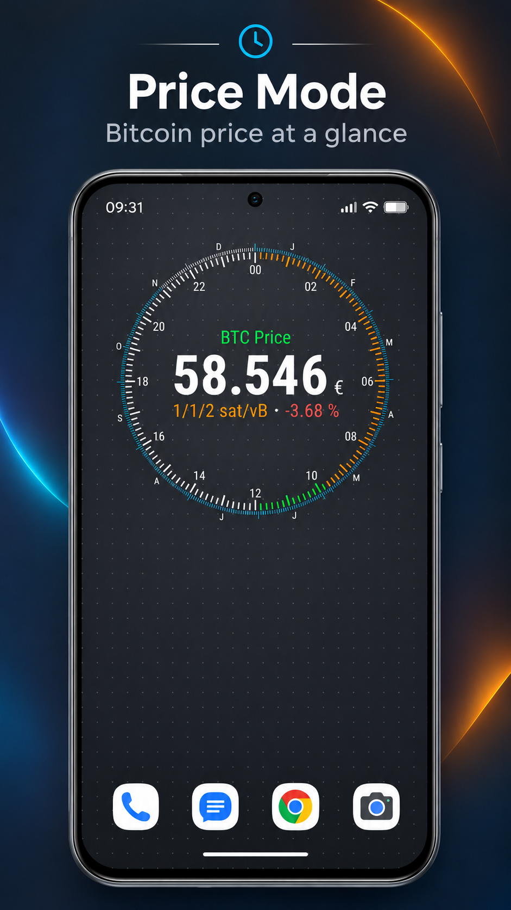
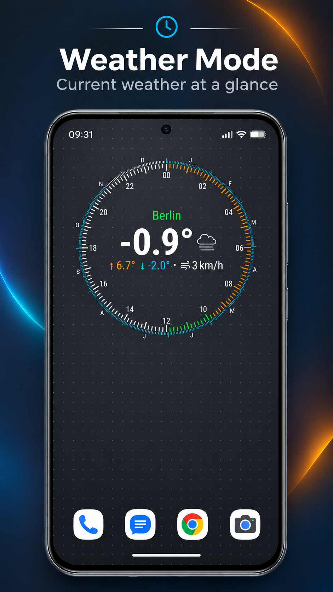
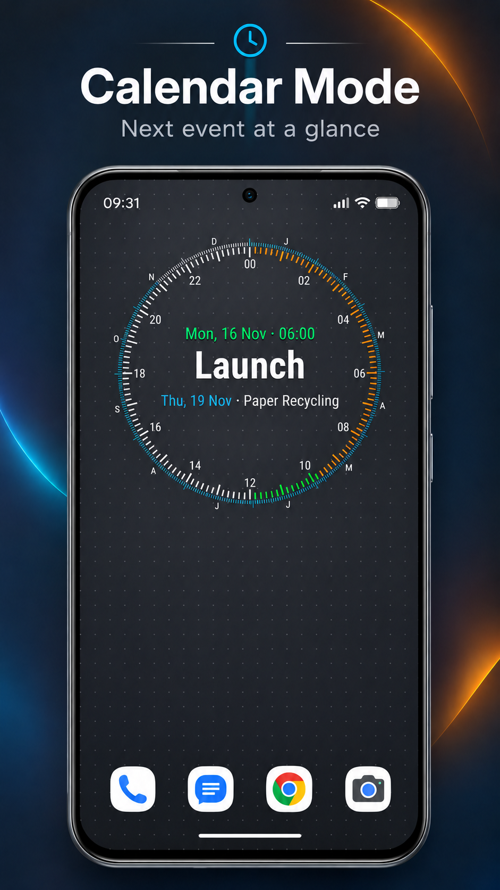

# Blockzeit 0.476

Android home screen widget for time, Bitcoin, weather and calendar. Android 12 or newer.

## Build

Requires JDK 17, Gradle 8.4 and Android SDK 34 with Build Tools 34.0.0.
Set `ANDROID_HOME` to your Android SDK directory, then run:

```sh
gradle --no-daemon :app:assembleDebug
```

The installable debug APK is created at `app/build/outputs/apk/debug/app-debug.apk`.
For an unsigned release APK, use `:app:assembleRelease`. Private signing keys are not included.

## Screenshots

    

## License

GNU General Public License v3.0. See [LICENSE](LICENSE).
